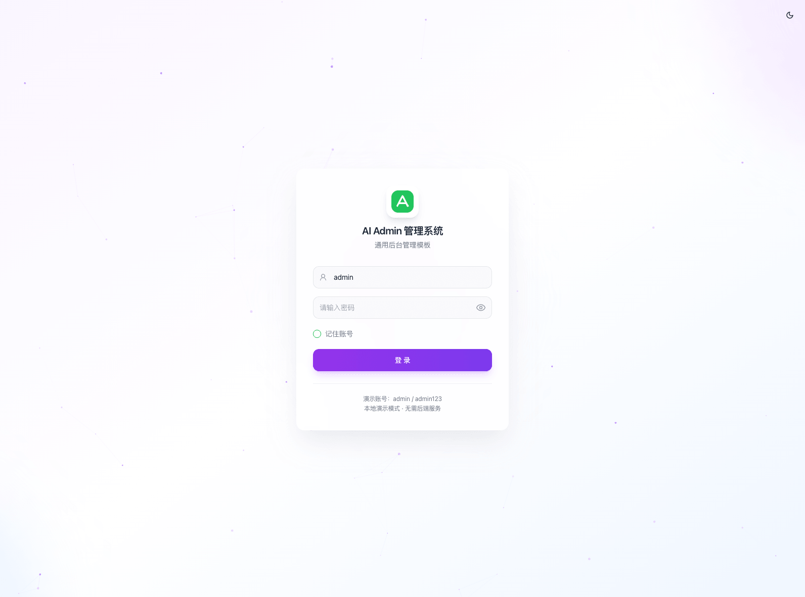
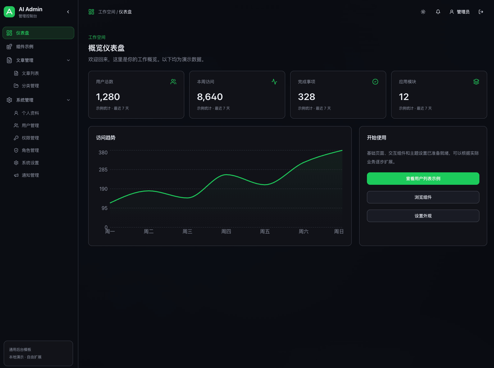
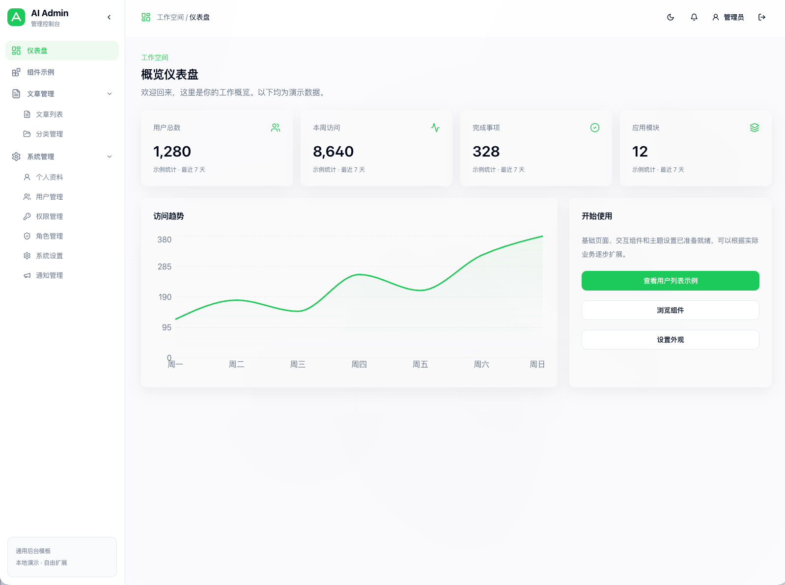

# AI Admin UI

基于 React、TypeScript 与 shadcn UI 的通用后台管理模板，提供响应式布局、深浅色主题、Markdown 文章管理、系统管理与通知中心。使用本地演示数据，安装依赖即可运行，无需启动后端。

[快速开始](#快速开始) · [界面预览](#界面预览) · [功能](#功能) · [开发指南](docs/DEVELOPMENT.md) · [部署说明](docs/DEPLOYMENT.md)

> 当前是本地演示模板：登录、角色配置和“发布”操作不提供生产服务端能力。详细边界见 [安全说明](SECURITY.md)。

## 界面预览

### 登录页

居中玻璃卡片搭配渐变与粒子背景，支持密码显隐、记住账号和主题切换。



### 后台 · 深色主题

冷黑背景与绿色强调色，结合层级菜单、统计卡片和访问趋势图。



### 后台 · 浅色主题

浅色背景与柔和卡片阴影，与深色主题共享布局和交互。



截图中的统计值均为演示数据。图片保存在仓库的 `docs/images/` 中，无需依赖外部图床。

## 快速开始

推荐 Node.js 22（最低 22.12），使用 npm 与仓库内的 lockfile。

```bash
git clone https://github.com/javaweb-sec/ai-admin-ui.git
cd ai-admin-ui
npm ci
npm run dev
```

访问终端输出的地址，默认 `http://localhost:5173`。演示账号 **admin**，密码 **admin123**。

## 功能

| 模块       | 内容                                                              |
| ---------- | ----------------------------------------------------------------- |
| 工作空间   | 仪表盘、图表、统计卡片                                            |
| 布局与主题 | 深浅色/跟随系统、全宽自适应布局、层级侧栏、折叠状态记忆           |
| 文章管理   | 搜索筛选分页、分类层级与图标、新增/编辑、置顶、状态切换、批量删除 |
| Markdown   | 实时预览、代码高亮、表格列表、图片链接、自动草稿恢复              |
| 系统管理   | 个人资料、用户列表示例、角色与权限配置、外观设置                  |
| 通知管理   | 草稿、图标选择、预览、发布/撤回、通知中心与未读状态               |
| 组件示例   | 表单控件、弹窗抽屉、菜单、日历、提示、表格、骨架屏等              |

先在“文章管理 → 分类管理”建立启用分类，再新增文章。新文章默认草稿。封面支持本地图片（最大 1 MB）；正文图片通过 Markdown 链接添加，不包含远程上传或视频上传服务。

## 技术栈

React 18 · TypeScript · Vite · Tailwind CSS · shadcn UI / Radix UI · Zustand · React Router · Recharts · UIW Markdown Editor · Vitest

## 常用命令

| 命令                 | 用途                     |
| -------------------- | ------------------------ |
| `npm run dev`        | 本地开发                 |
| `npm run build`      | 类型检查与生产构建       |
| `npm run preview`    | 预览 dist                |
| `npm run test:run`   | 单次运行测试             |
| `npm run type-check` | TypeScript 检查          |
| `npm run format`     | 格式化源码、配置和文档   |
| `npm run check`      | 格式、测试、构建完整验证 |

## 项目结构

```text
docs/
  images/              登录页与后台截图
  DEVELOPMENT.md       开发与组件规范
  DEPLOYMENT.md        部署说明
src/
  components/ui/       shadcn/Radix 基础组件
  components/layouts/  后台布局
  components/admin/    管理页面共享组件
  config/              品牌与菜单
  contexts/            主题
  hooks/               通用 hooks
  pages/               业务演示与组件展示
  services/            本地认证、文章、图片适配器
  stores/              资料、权限、通知、导航与会话
  styles/              通用样式
  App.tsx              路由与守卫
```

## 数据与限制

数据保存在当前浏览器的 localStorage/sessionStorage，不会同步到服务器。用户列表示例为页面内存数据；其他模块的具体存储键见 [开发指南](docs/DEVELOPMENT.md)。退出登录不清除本地演示内容。

角色权限仅用于配置演示，尚无用户角色分配或服务端权限检查。通知发布仅进入本地通知中心，文章发布仅改变本地状态。生产使用需替换相关适配器。

## 文档

- [开发指南与 UI 规范](docs/DEVELOPMENT.md)
- [部署与 SPA 路由配置](docs/DEPLOYMENT.md)
- [贡献指南](CONTRIBUTING.md)
- [安全与漏洞报告](SECURITY.md)
- [GitHub 发布清单](docs/RELEASE.md)
- [第三方许可说明](THIRD_PARTY_NOTICES.md)

## 许可

项目采用 [MIT License](LICENSE)。第三方依赖保留各自许可。
